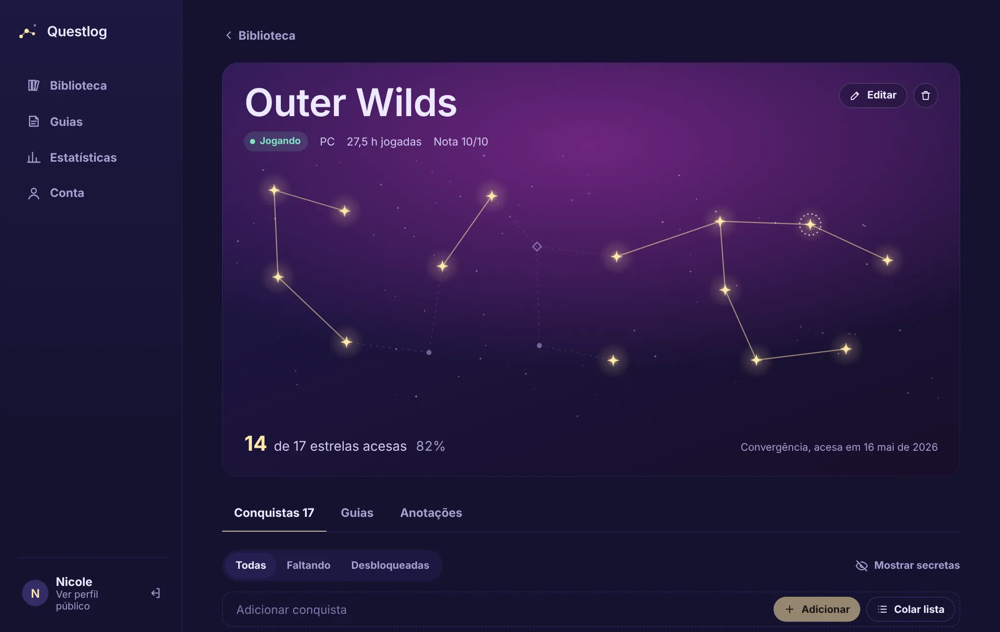
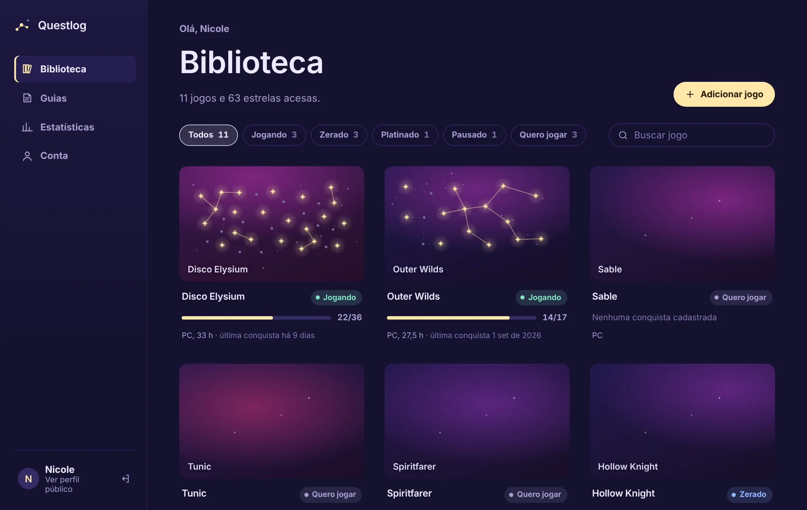
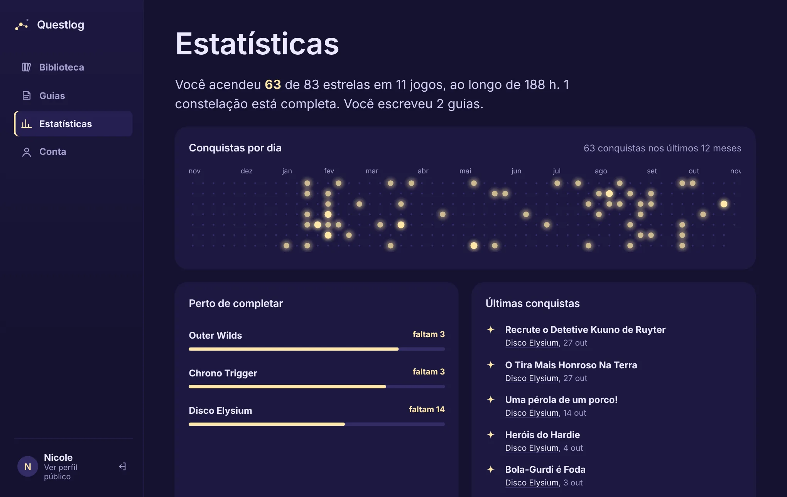
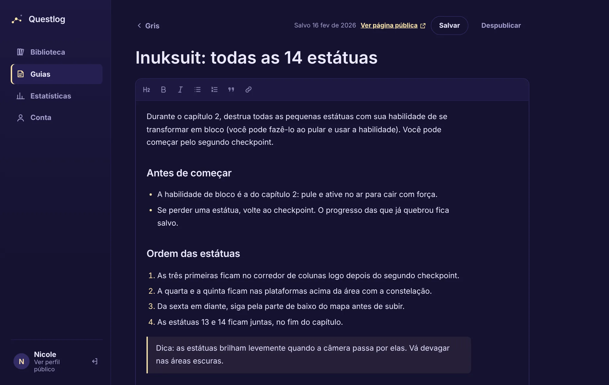
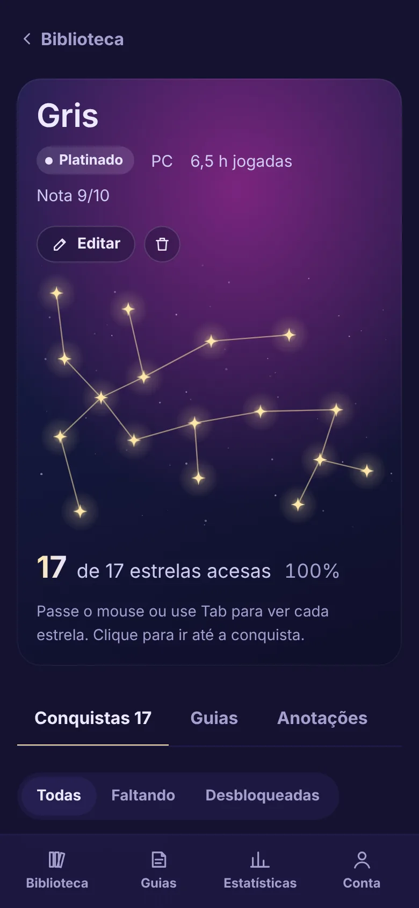

# Questlog

Rastreador de jogos e conquistas onde cada jogo é uma **constelação** e cada conquista é uma estrela que acende quando você a desbloqueia.



## Funcionalidades

- **Biblioteca** com status (jogando, zerado, platinado, pausado, na fila, abandonado), plataforma, horas, nota e busca.
- **Constelação por jogo** gerada de forma determinística: estrelas distribuídas por amostragem e ligadas por uma árvore geradora mínima. Clicar numa estrela marca a conquista.
- **Checklist de conquistas** com filtros, conquistas secretas, edição e importação em massa (uma por linha, `*` para secreta, ` - ` para descrição).
- **Guias** escritos num editor rich text (Tiptap), com rascunho/publicação, atalho `Ctrl+S` e aviso de alterações não salvas.
- **Estatísticas**: calendário de desbloqueios do último ano, jogos mais perto de completar, desbloqueios recentes e distribuição por status.
- **Perfil público** em `/u/:usuario` com vitrine de jogos e guias publicados.
- Layout responsivo: barra lateral no desktop, abas inferiores no celular.

| Biblioteca | Estatísticas |
| --- | --- |
|  |  |

| Editor de guias | Celular |
| --- | --- |
|  |  |

## Stack

| Camada | Tecnologias |
| --- | --- |
| Front-end | React 18, TypeScript, Vite, React Router, TanStack Query, Zustand, Tiptap, CSS Modules |
| Back-end | Node.js, Express, Drizzle ORM, PostgreSQL, Zod, JWT em cookie httpOnly, bcrypt, Helmet, rate limit |
| Compartilhado | Pacote `@questlog/shared` com schemas Zod, tipos e constantes usados nos dois lados |
| Qualidade | Vitest + Supertest (testes de integração com banco real), ESLint, GitHub Actions |
| Infra | Docker multi-stage, Docker Compose |

## Estrutura

```
questlog/
├── apps/
│   ├── api/                 Express + Drizzle
│   │   ├── drizzle/         migrações SQL
│   │   ├── src/
│   │   │   ├── db/          schema, cliente, migração e seed
│   │   │   ├── lib/         erros, helpers HTTP, slug
│   │   │   ├── middleware/  sessão e tratamento de erros
│   │   │   └── modules/     auth, games, achievements, guides, stats, profiles
│   │   └── test/
│   └── web/                 React + Vite
│       └── src/
│           ├── app/         rotas, guards e layouts
│           ├── components/  UI reutilizável (Constellation, Dialog, Field...)
│           ├── features/    auth, library, game, guides, stats, profile
│           ├── lib/         cliente da API, query keys, formatação
│           ├── stores/
│           └── styles/      tokens e estilos base
├── packages/
│   └── shared/              schemas Zod, tipos e constantes
├── docker-compose.yml
└── Dockerfile
```

Cada módulo da API segue `*.routes.ts` → `*.service.ts`, e cada feature do front tem suas páginas, componentes e hooks de dados juntos.

## Como rodar

Requisitos: Node 20+ e Docker Desktop aberto (ou um PostgreSQL local). Funciona no Windows, macOS e Linux.

```bash
npm install
cp apps/api/.env.example apps/api/.env
npm run db:up
npm run db:migrate
npm run db:seed
npm run dev
```

- Front: http://localhost:5173
- API: http://localhost:3333/api

Conta de demonstração: **nicole** / **questlog123**

## Testes

Os testes de integração usam um banco separado, `questlog_test`:

```bash
docker compose exec db createdb -U questlog questlog_test
npm test
```

Outros comandos: `npm run typecheck`, `npm run lint`, `npm run build`.

## API

Todas as rotas ficam em `/api`. As marcadas com 🔒 exigem sessão.

| Método | Rota | Descrição |
| --- | --- | --- |
| POST | `/auth/register` | Cria conta e inicia sessão |
| POST | `/auth/login` | Entra |
| POST | `/auth/logout` | Sai |
| GET / PATCH | `/auth/me` | Usuário atual / editar perfil 🔒 |
| GET / POST | `/games` | Lista / cria jogos 🔒 |
| GET / PATCH / DELETE | `/games/:id` | Detalhe com conquistas / edita / remove 🔒 |
| POST | `/games/:id/achievements` | Adiciona conquista 🔒 |
| POST | `/games/:id/achievements/bulk` | Importa várias conquistas 🔒 |
| PATCH / DELETE | `/achievements/:id` | Marca, edita ou remove 🔒 |
| GET / POST | `/games/:id/guides` | Guias do jogo / cria guia 🔒 |
| GET | `/guides` | Todos os guias 🔒 |
| GET / PATCH / DELETE | `/guides/:id` | Detalhe / edita / remove 🔒 |
| GET | `/stats` | Estatísticas 🔒 |
| GET | `/u/:username` | Perfil público |
| GET | `/u/:username/guides/:slug` | Guia publicado |

## Deploy

Em produção a API também serve o front compilado, então tudo roda num único serviço:

```bash
docker compose --profile app up --build
```

Para Render ou Railway: crie um PostgreSQL, faça deploy do `Dockerfile` e defina `DATABASE_URL`, `JWT_SECRET` e `WEB_ORIGIN`. As migrações rodam automaticamente ao iniciar.

## Decisões

- **Drizzle em vez de Prisma**: schema em TypeScript, SQL previsível e sem binários de engine.
- **Schemas compartilhados**: o mesmo Zod valida o formulário no front e o corpo da requisição na API.
- **Atualização otimista** ao marcar conquistas, para a estrela acender na hora.
- **Sessão em cookie httpOnly** em vez de token no localStorage.
